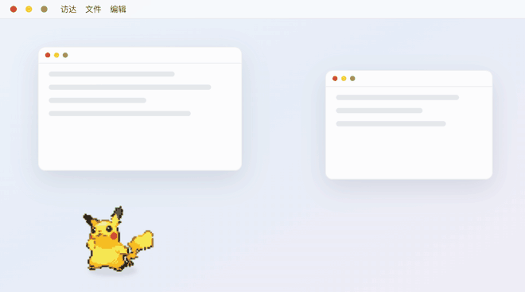
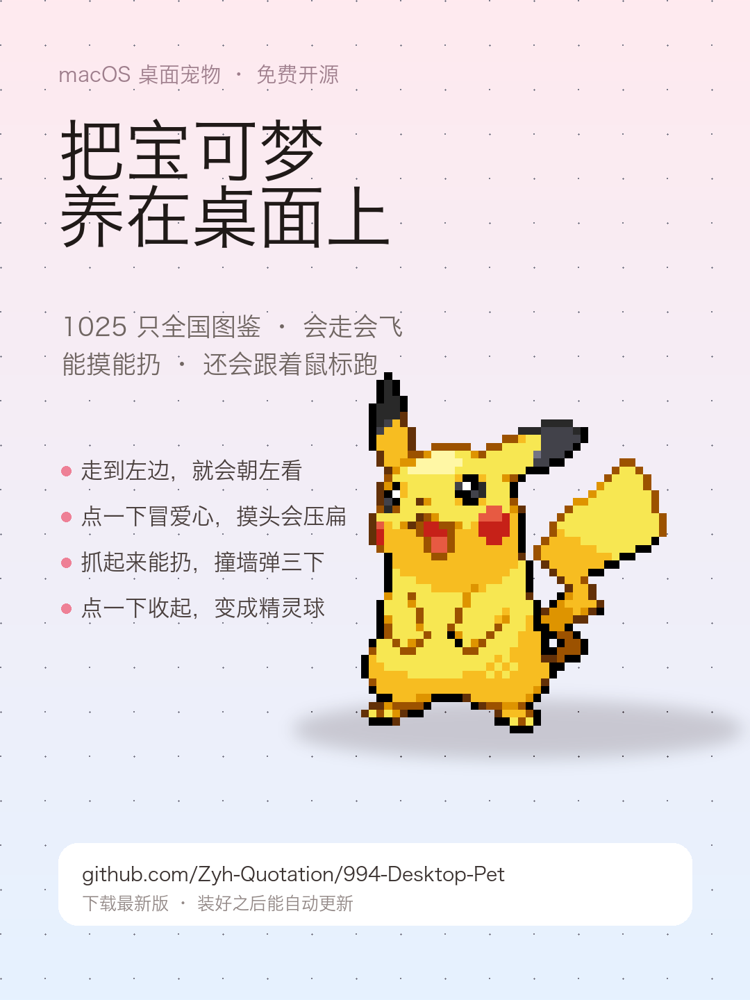
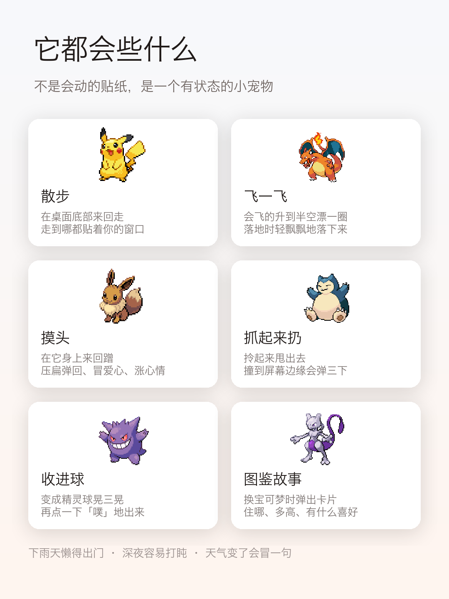
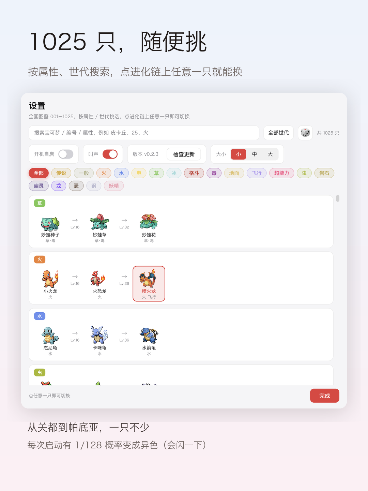
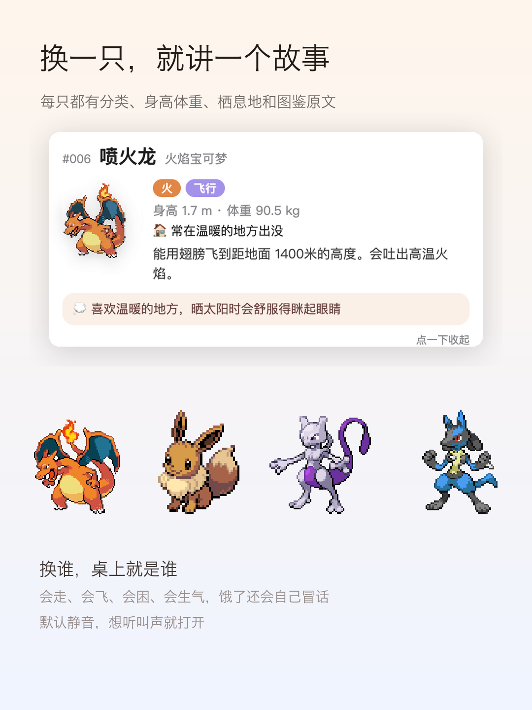

# 桌面宠物



把宝可梦养在桌面上。1025 只全国图鉴，会走会飞，能摸能扔，饿了会抱怨。

Electron 写的，免费开源，**macOS / Windows 都能装**。

**[⬇️ 下载（自动识别你的系统）](https://zyh-quotation.github.io/994-Desktop-Pet/)** ·
[所有版本](https://github.com/Zyh-Quotation/994-Desktop-Pet/releases) ·
[更新日志](https://github.com/Zyh-Quotation/994-Desktop-Pet/releases)

当前版本 **v0.7.1**（2026-11-04）：修复「开机自启」开关打不开、超级进化后点「形态专属招式」没反应两个问题；16 个暂时没有官方立绘的新形态（含超级戟脊龙）改用本体图 + 形态色描边/呼吸光环区分，素材更新后自动恢复专属立绘。上一版新增提醒事项/闹钟、多宠物同屏放养、心情饱食度健康曲线、天气联动野外遭遇、照片自定义伙伴，软件更名「桌面宠物」。

---

## 它是什么

不是会动的贴纸，是一个有状态的宠物：饱食度、心情、作息都在跑，关掉再打开还在。

窗口即宠物 —— 一个紧贴精灵的透明置顶窗口，空白处点击穿透，不影响你操作桌面上的任何东西。

| | |
|---|---|
|  |  |
|  |  |

## 怎么玩

- **会进化**：喂食 / 玩耍 / 摸头 / 放招式都能攒经验，每 100 点升 1 级。
  等级够了就进化 —— 妙蛙种子 Lv.16 变妙蛙草、Lv.32 变妙蛙花。白闪一下换形态，
  图鉴自动记下。伊布那 8 条分支会随机挑一种
- **超级进化 / 超极巨化**：喷火龙、妙蛙花、水箭龟、皮卡丘、伊布等 **115 种、131 个形态**。
  右键宠物、托盘菜单或「伙伴」页点一下就能变身：超级进化持续 2 分钟，超极巨化持续 90 秒，
  自动变回原样，**没有冷却，随时可以再次变身**；有异色形态的会跟着当前异色状态切换，喷火龙 X / Y 可以选。
  变身时会播放专属演出（闪白、能量环、粒子爆散和形态/招式横幅），每个形态还有自己的专属招式。
  没有动画图的少数新形态会退回本体图 + 光效，不会白屏
- **中文 / English / 日本語 / 한국어**：设置页一键切换界面语言；1025 只宝可梦、131 个形态和专属招式都有日文 / 韩文名，
  长文图鉴暂时用英文兜底。切语言不用重启，宠物、设置、孵蛋页一起换，
  界面、图鉴名、属性、形态名、招式名、托盘、气泡、故事卡正文和成就说明都跟着变
- **喂食和玩耍有动作**：食物从上面掉到嘴边被一口吃掉、冒爱心、小跳两下；
  球弹出去又弹回来，它会扑腾着去追
- **成就墙**：30 个徽章，带进度；成就页还有连续签到 / 累计签到 / 陪伴天数，以及一整年的签到 + 活动热力图
- **专注模式 / 番茄钟**：一键让它闭嘴别跑；25 或 45 分钟到点喊你起来动一动
- **拍照分享**：生成一张图鉴卡 PNG（编号、属性、专属招式、图鉴描述、异色金标）
- **自动换一只**：5 分钟到 3 小时任选，到点自己换个新的出来；最多 12 只的「伙伴队伍」可随时切换
- **昵称和饰品**：伙伴页改名；帽子（鸭舌帽 / 礼帽 / 皇冠）和围巾（红 / 蓝 / 绿）会显示在桌宠身上
- **每日 / 每周任务**：走路、喂食、摸头、玩耍、招式、签到、孵蛋等，完成后领取经验和进化石
- **通知中心**：捡蛋、孵蛋、进化、成就、任务、久坐 / 喝水提醒都会入档，可标记已读、清空、开系统通知；重启不丢
- **存档不丢**：存档带版本号，另一个实例写入了更新的进度后本实例不再覆盖；
  备份保留两代（`.bak` / `.bak2`），从开发链接版覆盖成正式包时自动迁移存档
- **主题皮肤**：默认 / 樱花 / 海洋 / 森林 / 节日，可开「节日自动换肤」；圣诞、新年、情人节、国庆、万圣节等自动换
- **辅助功能**：减少动画、高对比度、界面缩放 90%–125%、叫声音量、久坐 / 喝水提醒间隔
- **逐步解锁**：第一次打开只给一只初始伙伴，其余 1024 只靠孵蛋和进化解锁，
  图鉴里没解锁的会灰掉上锁
- **孵蛋页**：独立窗口显示进度环、倒计时和已走距离，蛋到手可一键孵化
- **收藏**：图鉴卡片右上角点 ♡ 收藏，顶部「♥ 收藏」只显示收藏的
- **陪伴报告**：陪你多少天、走了多少米、摸头多少次，一键存成图片
- **接球小游戏**：30 秒里它自己跑着接球，接几个给几个经验
- **久坐 / 喝水提醒**：坐 45 分钟喊你动一动，每小时提醒喝水
- **生日与节日**：每年生日冒蛋糕，圣诞 / 元旦 / 情人节 / 国庆有彩蛋
- **鼠标跟随**：偶尔走过来蹲在你光标旁边
- **进化石**：签到 / 孵蛋获得，不用等等级直接进化（火之石、水之石……）
- **爬屏幕边**：走到屏幕左右边缘会顺着边爬上去待一会儿
- **右键菜单**：直接在宠物身上右键，喂食 / 玩耍 / 招式 / 看介绍
- **性格**：开朗 / 慵懒 / 胆小 / 傲娇 / 贪吃 / 爱睡，由图鉴编号决定，
  影响跑动速度、睡觉频率、怕不怕人
- **蛋**：走十来分钟捡一颗蛋，点一下孵出还没遇见过的宝可梦
- **串门**：隔一阵子有别的宝可梦跑过来待一会儿（可关掉）
- **多宠物同屏放养**：「伙伴」页可把队伍里最多 3 只放到桌面上溜达。它们彼此靠近会打招呼、追来追去、一起玩，
  还会和串门访客互动，主角在场时心情 +5、经验 +8
- **提醒事项 / 闹钟**：设置 →「提醒」里加一条，定好时间和重复星期（不选 = 每天）。
  到点桌宠冒气泡提醒，同时记进通知中心；专注模式下不打扰
- **心情 / 饱食度健康曲线**：每 30 秒采样一次攒成日均，设置 →「健康」里有近 30 天曲线、
  当前值进度条、近一年平均心情 / 饱食度
- **天气联动野外遭遇**：下雨更容易遇到水 / 虫 / 草系，雷雨遇电系，下雪遇冰系，晴天遇火 / 草系，
  夜里遇幽灵 / 恶系；串门气泡也会提到天气（"下雨天，野生 XX 跑来串门了！"）
- **照片自定义伙伴**：设置 →「伙伴」→「导入照片」，选一张猫狗照片，本地用 macOS Vision 抠图后
  它就出现在桌面上陪你一起溜达（最多 2 只）。**照片只在本机处理，不会上传到任何服务器**
- **每日签到**：每天首次打开 +50 经验，连续 7 天解锁成就
- **会累**：内存吃紧时走得慢、冒汗；下雪喊冷、打雷吓一跳
- **异色**：1025 只全都有异色版。托盘 →「异色 ✨」可以选「自动（1/128 彩蛋）」
  「总是异色」或「始终正常」；自动模式下每只的结果是固定的，不会切来切去就变
- **专属动作**：每只宝可梦都有自己的招式。点击菜单栏图标 →「专属动作 ✨」，或者等它发呆时自己放（会冒招式名，配自己的叫声）
  - 1025 只全覆盖：从各世代的升级招式表里挑本系招，威力跟着进化阶段走 —— 妙蛙种子是藤鞭、水箭龟才是加农水炮、皮卡丘是十万伏特
  - 428 种不同招式：粒子形状跟着**招式属性**走，颜色从这只自己的精灵图里取 —— 同为水系，杰尼龟和鲤鱼王的特效也不一样


| 操作 | 反应 |
|---|---|
| 轻点一下 | 冒爱心，心情 +3 |
| 在它身上来回蹭 | 摸头：压扁弹回、冒爱心、持续涨心情 |
| 1.5 秒内连点三下 | 生气，转身背对你 |
| 按住拖动 → 甩出去 | 抓起来挣扎、重力坠落、撞屏幕边缘弹三下，摔狠了会生气 |
| 托盘 → 收进球 | 变成精灵球晃三晃，点一下「噗」地出来 |
| 托盘 → 飞一飞 | 会飞的宝可梦升到半空漂一圈，落地有缓冲 |
| 托盘 → 喂食 / 玩耍 / 打盹 | 饱食度 +35 / 心情 +25 / 强制睡觉 |
| 托盘 → 随机一只 | 从 1025 只里随机换，不会抽到当前这只 |

自己会做的事：散步（往左走就朝左看）、偶尔跟着鼠标跑、跨屏走到另一块显示器、
深夜打盹、下雨懒得动、饿了冒话、发呆时打哈欠抓痒、飞行时影子随高度缩小变淡。

## 图鉴

设置页里按 **属性（18 种）/ 世代（一～九）/ 名字 / 编号** 搜索，按 540 条进化链展示，
点进化链上任意一只就能换。换的时候旁边弹一张故事卡：分类、身高体重、栖息地、图鉴原文、喜好。

- 1025 只全收录，其中 **94 只传说与幻兽**，金色徽章标注
- 每只都有 **异色版本**，每次启动有 **1/128** 概率刷出
- 1025 条图鉴原文 + 真实叫声（默认关闭）

## 装哪个

| 系统 | 文件 | 怎么装 |
|---|---|---|
| macOS（Apple 芯片） | `pokepet-x.y.z.zip` | 解开，把「桌面宠物.app」拖进「应用程序」 |
| macOS（Intel 芯片） | `pokepet-x.y.z-mac-x64.zip` | 同上，装 Intel 专用包（解开后同样叫「桌面宠物」） |
| Windows 10/11 64 位 | `pokepet-x.y.z-win-x64.zip` | 解压到固定文件夹，双击 `TogepiPet.exe` |

- Mac 版没买苹果开发者签名（ad-hoc 签名），首次打开会被系统拦下。
  **macOS 15 以后「右键 → 打开」已经不给按钮了**，要去「系统设置 → 隐私与安全性」点「仍要打开」，
  或者直接执行 `xattr -dr com.apple.quarantine /Applications/桌面宠物.app` 再双击
- 下载页会自己判断你是 Apple 芯片还是 Intel，不用手选；认不出来时会同时给出 Intel 版链接
- 安装包体积大（Apple 芯片约 257MB / Intel 约 261MB / Windows 约 288MB），
  因为 1025 只精灵图、形态动画和叫声都在里面

装好之后：托盘点「检查更新 ⟳」，或启动 8 秒后自动查、之后每 6 小时一次。
找到新版本会直接后台下载并覆盖安装，不再弹窗确认；这次改了什么，会在更新完成后的第一次启动展示。
Mac（Apple 芯片 / Intel）和 Windows 便携版都是原地升级并保留存档，清单里的 `builds`
会按本机架构自动挑对应的包（要带上 Intel / Windows 包，发版前先跑 `tools/build-app-intel.sh`、
`tools/build-win.sh`，再跑 `tools/make-release.js`）；开发模式和没有清单时会退回下载页。

## 开发

```bash
npm install
npm start                 # 开发模式，改动即时生效
```

### 单独打包

```bash
./tools/build-app.sh          # Mac（Apple 芯片）：组装 release/桌面宠物.app 并签名
bash tools/build-app-intel.sh # Mac（Intel）：release/pokepet-<版本>-mac-x64.zip
bash tools/build-win.sh       # Windows：release/pokepet-<版本>-win-x64.zip
```

### 发版

一条命令跑完（升版本号 → 签名 → 打平台包 → 生成 `update.json`）：

```bash
./tools/publish.sh patch "这次修了什么"      # 也可用 minor / major / 0.7.0
GH_RELEASE=1 ./tools/publish.sh patch "…"    # 带上这个变量就会顺手上传 Release
```

`publish.sh` 默认会带上 Intel 和 Windows 包（`SKIP_INTEL=1` / `SKIP_WIN=1` 可跳过），
上传时会把 zip 和 `update.json` 一起挂到 Release 上，应用内「检查更新」读的就是这份清单。

手工打包时先改 `package.json` 的版本号（用 `publish.sh` 会自动升），并在 `data/changelog.json` 里加同版本的
`new` / `fix` 条目；`tools/make-release.js` 会自动把它写进 `update.json` 的 `notes`，更新说明就有内容了。

### 目录

```
main.js              主进程：窗口、托盘、状态机、物理（33ms 一帧）、更新
preload.js           宠物窗口的安全桥
settings-preload.js  设置窗口的安全桥
renderer/            显示层：宠物窗口 + 设置页 + 故事卡
data/pokedex.json    1025 只：中文名、属性、世代、进化链
data/lore.json       1025 条：分类、栖息地、图鉴原文、身高体重（含英文）
data/signatures.json 1025 只的专属动作：中英文招式名 + 粒子形状 + 动作 + 配色
data/names-en.json   1025 只的英文名（图鉴搜索、托盘、气泡用）
data/names-ja.json   1025 只的日文名
data/names-ko.json   1025 只的韩文名
data/forms.json      131 个超级进化 / 超极巨化形态：中英文名、属性、形态编号
data/form-moves.json 131 个形态的专属招式：中 / 英 / 日 / 韩招式名、属性、特效
data/changelog.json  版本更新说明：新增功能 / 修复内容，更新弹窗和 release 清单共用
assets/pokemon/      2050 张精灵图（普通 + 异色，121MB，不进仓库）
assets/forms/        超级进化 / 超极巨化动画图（普通 + 异色，约 52MB，不进仓库）
assets/cries/        1025 条叫声（16MB，不进仓库）
docs/                GitHub Pages 下载页（latest.json 是页面读的版本清单）
tools/               打包、素材抓取脚本
tools/signature-moves.json  招式名数据源（可手工改，改完重跑 build-signatures）
promo/               宣传图和文案
```

素材不进 git。新机器拉下来后补一次：

```bash
node tools/fetch-sprites.js     # 下载精灵图
node tools/fetch-cries.js       # 下载叫声
node tools/fetch-forms.js       # 下载超级进化 / 超极巨化形态图
node tools/build-form-moves.js  # 重新生成形态专属招式表（保留已有日 / 韩译名）
npm install                     # Electron

英文名（data/names-en.json）、英文图鉴文本（data/lore.json）和英文招式名（data/signatures.json）
已经随仓库提供；只有想换数据源时才需要 `tools/build-names-en.js`、`tools/build-lore-en.js`、
`tools/build-signatures-en.js`（先放好 `tools/csv/` 下的 PokeAPI CSV）。
形态表 `data/forms.json` 由 `tools/build-forms.js` 从 PokeAPI CSV 生成（同样需要 `tools/csv/`）；
形态动画由 `tools/fetch-forms.js` 从 Pokémon Showdown / PokeAPI sprites 抓取。
```

## 技术笔记

- **点击穿透**：`setIgnoreMouseEvents(true, { forward: true })` + 渲染层命中测试，
  指针在精灵上时关掉穿透，移到外面再打开
- **物理**：主进程 33ms tick，重力 1900，抛掷继承拖动速度，撞屏幕边缘按系数反弹
- **飞行**：用 `--alt` 变量驱动精灵上浮、影子缩小变淡，不是换一张图
- **朝向**：`scaleX(-1)` 镜像
- **多屏**：判断宠物落在哪块屏，走到边界时切到相邻屏继续
- **天气**：wttr.in 每 30 分钟拉一次，失败就静默跳过
- **更新清单**：`releases/latest/download/update.json`，含版本、sha256、下载地址和更新说明；
- **下载页清单**：`docs/latest.json`，页面同源读它拿三个平台的 zip 直链，不碰 `api.github.com`
  （匿名 60 次/小时，挂了页面就会退回「打开下载页」）。发版时由 `tools/publish.sh`
  里的 `make-release.js` 顺带生成，`.github/workflows/latest-json.yml` 也会在 Release
  发布后自动同步一次，忘了提交也不会指向旧版本；
  请求加时间戳绕开 CDN 一分钟缓存；清单里的 `notes` 来自 `data/changelog.json`
- **更新流程**：检查到新版本直接后台下载并覆盖安装，不再二次确认；更新完成后首次启动用 `lastSeenVersion`
  判断版本变化，再展示本次更新说明；更新前会把说明暂存进存档，避免旧版本来不及带过来
- **分包下载**：清单里的 `builds.arm64` / `builds.x64` / `builds.win` 对应三个平台的包，
  主进程按 `process.arch` 取 Mac 包、Windows 取 `builds.win`，不会再给 Intel 机器推 arm64 包

## 素材与版权

精灵图和叫声来自 [PokeAPI](https://github.com/PokeAPI)，宝可梦版权属于任天堂 / Game Freak / Creatures。
**仅供个人使用，请勿商用。**

图鉴数据由 `tools/build-pokedex.js` 从 PokeAPI 数据集生成，故事文本由 `tools/build-lore.js` 生成，
专属招式由 `tools/build-signature-moves.js` 从各世代升级招式表挑选（首次运行自动下载数据到 `tools/.cache/`）。
